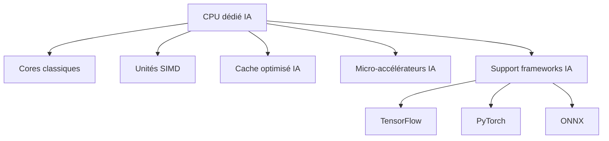
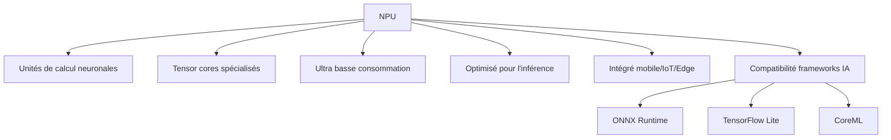
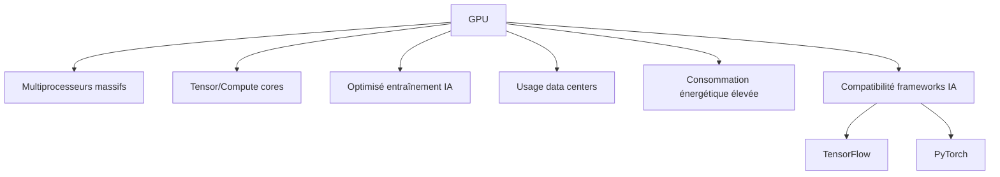

<!-- MASTER-HEADER-START -->
<div align="center">

<a href="https://0xcyberlitech.com/">
  
</a>

<p align="center">
  <a href="https://0xcyberlitech.com/"></a>
  <a href="https://0xcyberlitech.com/soc-rd.html"></a>
  <a href="https://0xcyberlitech.com/jarvis-rd.html"></a>
  <a href="https://github.com/0xCyberLiTech?tab=repositories"></a>
</p>
<p align="center">
  <a href="README.md"></a>
</p>


</div>
<!-- MASTER-HEADER-END -->

<!-- DEBIAN-TRUTH-START -->
> [!IMPORTANT]
>  ** Matrice Officielle Debian — `Debian 12 (Bookworm)` · `Debian 13 (Trixie)` · `Debian 14 (Forky)`**
> - **Sources Officielles Debian.org (`python3-defaults`) :** `Bookworm (12)` : **`3.11.2-1`** &nbsp;·&nbsp; `Trixie (13 — Stable)` : **`3.13.5-1`** &nbsp;·&nbsp; `Forky (14 — Next-Gen)` : **`3.14.7-3`**
> - **Références Officielles :** [Paquet Debian Trixie (`python3`)](https://packages.debian.org/trixie/python3) &nbsp;·&nbsp; [Paquet Debian Forky (`python3`)](https://packages.debian.org/forky/python3) &nbsp;·&nbsp; [Documentation Officielle Debian](https://wiki.debian.org/Python)
> - **Note d'Ingénierie (Divergence 13 vs 14) :** Depuis Debian 12/13 (Trixie) et renforcé sous Debian 14 (Forky), la norme **PEP 668** bloque `pip install` en global pour protéger APT : utilisez systématiquement `python3 -m venv` ou `pipx`.

<details>
<summary> <b>Afficher les Encarts Ligne de Commande : Debian 13 (Trixie — Stable) vs Debian 14 (Forky — Next-Gen)</b></summary>

####  Profil Production Stable — Commandes pour `Debian 13 (Trixie)`
```bash
# Debian 13 (Trixie — Python 3.13 & PEP 668) : Environnement virtuel obligatoire pour pip
sudo apt update && sudo apt install -y python3-venv python3-pip pipx
python3 -m venv .venv && source .venv/bin/activate
```

####  Profil Anticipation Next-Gen — Commandes pour `Debian 14 (Forky)`
```bash
# Debian 14 (Forky — Python 3.13/3.14) : Isolation stricte PEP 668 & outils CLI via pipx
pipx install huggingface-hub
python3 -m venv --upgrade-deps .venv
```

</details>
<!-- DEBIAN-TRUTH-END -->

<!-- CIEL-PEDAGOGY-START -->
<details>
<summary> <b>Synthèse d'Architecture, Standards Officiels &amp; Diagnostic (Niveau 1 : Fondamentaux · Niveau 2 : Repères · Niveau 3 : Diagnostic)</b></summary>

- **Niveau 1 — Fondamentaux &amp; Principe d'Architecture :** L'architecture d'**Intelligence Artificielle Souveraine (LLM Local, RAG Vectoriel & Pipeline Vocal)** permet d'orchestrer des modèles de langage (`Qwen 3.5`, `Llama`, `Mistral` via `Ollama`) et une recherche documentaire vectorielle privée (`SQLite-vec` / `Qdrant`) intégralement sur serveur local (*On-Premise*), garantissant la confidentialité absolue des données.
- **Niveau 2 — Repères Officiels (Ports IANA, Fichiers Debian &amp; Commandes de Validation) :** **Ports & Composants standards :** `TCP 11434` (API Ollama `qwen3.5:9b` / `qwen3-embedding:4b`) · Extension native `SQLite-vec` (`vec0` L2/Cosine) · `TCP 6333` (Qdrant) &nbsp;|&nbsp; **Validation & Télémétrie :** `nvidia-smi`, `ollama ps`, `curl -s http://127.0.0.1:11434/api/tags`.
- **Niveau 3 — Diagnostic d'Incidents &amp; Ingénierie Avancée :** **Diagnostic & Architecture :** Contrairement au *Fine-Tuning* qui fige des connaissances dans les poids du modèle, l'architecture **RAG (*Retrieval-Augmented Generation*)** indexe la documentation technique sous forme de vecteurs (*Embeddings*) et injecte dynamiquement les extraits exacts dans le contexte du LLM avec une `temperature` basse (`0.1`), éliminant les hallucinations.
- **Sources de Vérité Officielles Éditeurs &amp; Standards :** [Documentation Officielle Ollama](https://github.com/ollama/ollama) &nbsp;·&nbsp; [Documentation Officielle SQLite-vec](https://alexgarcia.xyz/sqlite-vec/) &nbsp;·&nbsp; [Documentation Llama.cpp / GGML](https://github.com/ggml-org/llama.cpp)

</details>
<!-- CIEL-PEDAGOGY-END -->


> Guide complet expliquant, étape par étape, le fonctionnement, l’installation et l’utilisation de solutions d’intelligence artificielle sur Debian 12 et Debian 13.

---

<div align="center" style="margin-bottom: 10px;">

###  **Sommaire**

 **Actif** – Dépôt totalement accessible 
 **Partiel** – Dépôt partiellement accessible 
 **Inactif** – Dépôt inaccessible ou indisponible

</div>

---

<div align="center">
  
#  Architectures des processeurs dédiés à l’Intelligence Artificielle

</div>

L’intelligence artificielle a révolutionné la conception des processeurs. Aujourd’hui, on distingue plusieurs architectures matérielles pensées spécifiquement pour les tâches de l’IA : les CPUs optimisés, les NPUs spécialisés et les GPUs massivement parallèles.  
Comprendre leurs rôles et leurs interactions permet de mieux choisir le matériel adapté à vos besoins IA (inférence, entraînement, embarqué, edge, data center, etc.).

---

##  01 // CPU dédié IA




**Le CPU dédié IA est un processeur central traditionnel, modifié pour intégrer des instructions SIMD (vectorisation), des caches améliorés et des micro-accélérateurs IA. Il offre une prise en charge optimale des frameworks modernes, et équipe fréquemment les appareils grand public ou IoT. Sa polyvalence lui permet d’exécuter des tâches IA variées de façon fiable.**

---

##  02 // NPU (Neural Processing Unit)




**Le NPU est une puce spécialisée pour accélérer le calcul des réseaux de neurones tout en limitant la consommation énergétique. Il est idéal pour l’inférence rapide, essentielle dans les smartphones, robots et objets embarqués, grâce à ses “tensor cores” et sa compatibilité avec ONNX Runtime, TensorFlow Lite et CoreML.**

---

##  03 // GPU (Graphics Processing Unit) pour IA




**Le GPU est composé de milliers de cœurs parallèles et de cœurs tensoriels, parfait pour entraîner des modèles volumineux. Il se retrouve surtout dans les data centers : la puissance de calcul qu’il offre pour l’apprentissage profond est très élevée, mais sa consommation d’énergie l’est aussi. Il est totalement compatible avec les principaux frameworks IA comme TensorFlow et PyTorch.**

---

**À retenir :**  
Chaque architecture a ses atouts : le CPU IA est polyvalent, le NPU est ultra-efficace pour l’embarqué, et le GPU est roi pour l’entraînement massif.  
L’évolution matérielle IA bénéficie souvent de leur collaboration pour maximiser vitesse, efficacité, et coût énergétique.

<!-- MASTER-FOOTER-START -->
<div align="center">


<a href="https://0xcyberlitech.com/">
  
</a>

<p align="center"><a href="https://0xcyberlitech.com/"></a></p>

<sub><b>Architecturé &amp; Forgé par Marc &amp; Antigravity (Google DeepMind)</b> &nbsp;·&nbsp; <a href="https://0xcyberlitech.com/"><b>0xcyberlitech.com</b></a> &nbsp;·&nbsp; <a href="https://0xcyberlitech.com/soc-rd.html">Architecture SOC Cockpit v5.5</a> &nbsp;·&nbsp; <a href="https://0xcyberlitech.com/jarvis-rd.html">Architecture JARVIS Mark-VII</a> &nbsp;·&nbsp; <a href="https://0xcyberlitech.com/blueprint-jarvis.html">Blueprint Matériel RTX 5080</a></sub>

</div>
<!-- MASTER-FOOTER-END -->
