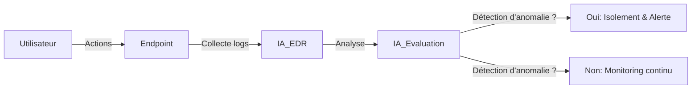
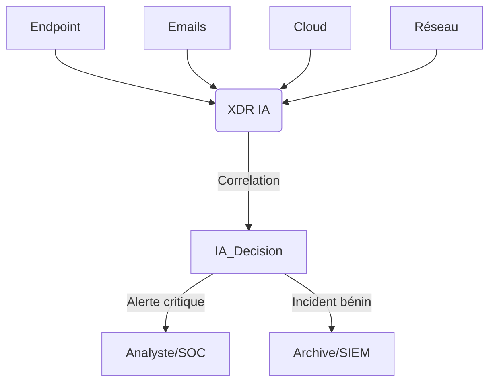
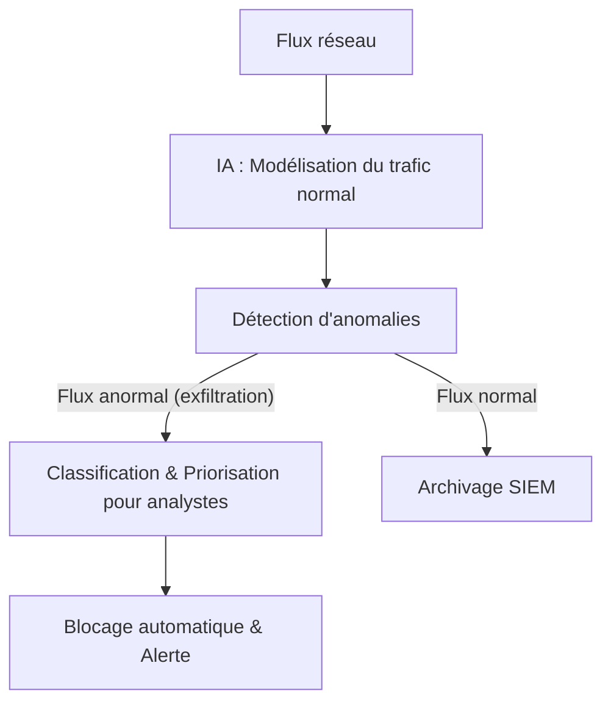
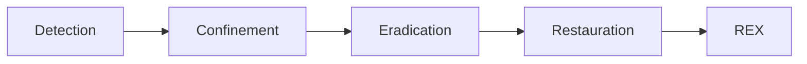

<!-- MASTER-HEADER-START -->
<div align="center">

<a href="https://0xcyberlitech.com/">
  
</a>

<p align="center">
  <a href="https://0xcyberlitech.com/"></a>
  <a href="https://0xcyberlitech.com/soc-rd.html"></a>
  <a href="https://0xcyberlitech.com/jarvis-rd.html"></a>
  <a href="https://github.com/0xCyberLiTech?tab=repositories"></a>
</p>
<p align="center">
  <a href="README.md"></a>
</p>


</div>
<!-- MASTER-HEADER-END -->

<!-- DEBIAN-TRUTH-START -->
> [!IMPORTANT]
>  ** Matrice Officielle Debian — `Debian 12 (Bookworm)` · `Debian 13 (Trixie)` · `Debian 14 (Forky)`**
> - **Sources Officielles Debian.org (`python3-defaults`) :** `Bookworm (12)` : **`3.11.2-1`** &nbsp;·&nbsp; `Trixie (13 — Stable)` : **`3.13.5-1`** &nbsp;·&nbsp; `Forky (14 — Next-Gen)` : **`3.14.7-3`**
> - **Références Officielles :** [Paquet Debian Trixie (`python3`)](https://packages.debian.org/trixie/python3) &nbsp;·&nbsp; [Paquet Debian Forky (`python3`)](https://packages.debian.org/forky/python3) &nbsp;·&nbsp; [Documentation Officielle Debian](https://wiki.debian.org/Python)
> - **Note d'Ingénierie (Divergence 13 vs 14) :** Depuis Debian 12/13 (Trixie) et renforcé sous Debian 14 (Forky), la norme **PEP 668** bloque `pip install` en global pour protéger APT : utilisez systématiquement `python3 -m venv` ou `pipx`.

<details>
<summary> <b>Afficher les Encarts Ligne de Commande : Debian 13 (Trixie — Stable) vs Debian 14 (Forky — Next-Gen)</b></summary>

####  Profil Production Stable — Commandes pour `Debian 13 (Trixie)`
```bash
# Debian 13 (Trixie — Python 3.13 & PEP 668) : Environnement virtuel obligatoire pour pip
sudo apt update && sudo apt install -y python3-venv python3-pip pipx
python3 -m venv .venv && source .venv/bin/activate
```

####  Profil Anticipation Next-Gen — Commandes pour `Debian 14 (Forky)`
```bash
# Debian 14 (Forky — Python 3.13/3.14) : Isolation stricte PEP 668 & outils CLI via pipx
pipx install huggingface-hub
python3 -m venv --upgrade-deps .venv
```

</details>
<!-- DEBIAN-TRUTH-END -->

<!-- CIEL-PEDAGOGY-START -->
<details>
<summary> <b>Synthèse d'Architecture, Standards Officiels &amp; Diagnostic (Niveau 1 : Fondamentaux · Niveau 2 : Repères · Niveau 3 : Diagnostic)</b></summary>

- **Niveau 1 — Fondamentaux &amp; Principe d'Architecture :** L'architecture d'**Intelligence Artificielle Souveraine (LLM Local, RAG Vectoriel & Pipeline Vocal)** permet d'orchestrer des modèles de langage (`Qwen 3.5`, `Llama`, `Mistral` via `Ollama`) et une recherche documentaire vectorielle privée (`SQLite-vec` / `Qdrant`) intégralement sur serveur local (*On-Premise*), garantissant la confidentialité absolue des données.
- **Niveau 2 — Repères Officiels (Ports IANA, Fichiers Debian &amp; Commandes de Validation) :** **Ports & Composants standards :** `TCP 11434` (API Ollama `qwen3.5:9b` / `qwen3-embedding:4b`) · Extension native `SQLite-vec` (`vec0` L2/Cosine) · `TCP 6333` (Qdrant) &nbsp;|&nbsp; **Validation & Télémétrie :** `nvidia-smi`, `ollama ps`, `curl -s http://127.0.0.1:11434/api/tags`.
- **Niveau 3 — Diagnostic d'Incidents &amp; Ingénierie Avancée :** **Diagnostic & Architecture :** Contrairement au *Fine-Tuning* qui fige des connaissances dans les poids du modèle, l'architecture **RAG (*Retrieval-Augmented Generation*)** indexe la documentation technique sous forme de vecteurs (*Embeddings*) et injecte dynamiquement les extraits exacts dans le contexte du LLM avec une `temperature` basse (`0.1`), éliminant les hallucinations.
- **Sources de Vérité Officielles Éditeurs &amp; Standards :** [Documentation Officielle Ollama](https://github.com/ollama/ollama) &nbsp;·&nbsp; [Documentation Officielle SQLite-vec](https://alexgarcia.xyz/sqlite-vec/) &nbsp;·&nbsp; [Documentation Llama.cpp / GGML](https://github.com/ggml-org/llama.cpp)
- **Livres Blancs &amp; 67 Podcasts Audio R&amp;D :** [Portail 0xCyberLiTech](https://0xcyberlitech.com/) &nbsp;·&nbsp; [Livre Blanc SOC Cockpit v5.5](https://0xcyberlitech.com/soc-rd.html) &nbsp;·&nbsp; [Livre Blanc JARVIS Mark-VII](https://0xcyberlitech.com/jarvis-rd.html) &nbsp;·&nbsp; [Blueprint Logiciel &amp; Matériel RTX 5080](https://0xcyberlitech.com/blueprint-jarvis.html)

</details>
<!-- CIEL-PEDAGOGY-END -->


> Guide complet expliquant, étape par étape, le fonctionnement, l’installation et l’utilisation de solutions d’intelligence artificielle sur Debian 12 et Debian 13.

---

<div align="center" style="margin-bottom: 10px;">

###  **Sommaire**

 **Actif** – Dépôt totalement accessible 
 **Partiel** – Dépôt partiellement accessible 
 **Inactif** – Dépôt inaccessible ou indisponible

</div>

---
<a name="intro"></a>

<div align="center">
  
#  1. Introduction à la cybersécurité et à l’IA

</div>

La cybersécurité protège les systèmes informatiques contre les menaces numériques. L’intelligence artificielle (IA) révolutionne ce domaine en permettant l’automatisation de la détection, de l’analyse et de la réaction face aux attaques, rendant la défense plus rapide, évolutive et efficace.

---

##  01 // L’IA au cœur des architectures EDR, XDR et NDR


L’IA est devenue l’élément clé des architectures modernes :  
- Elle automatise l’analyse de millions de données contextuelles.
- Elle apprend en continu des nouveaux scénarios d’attaque.
- Elle réagit en quelques secondes, bien plus vite que l’humain seul.

---

###  1. EDR (Endpoint Detection & Response) BOOSTÉ PAR L’IA

- **Surveillance comportementale** :  
  L’IA examine en temps réel chaque action sur le poste (fichiers ouverts, processus lancés, connexions, etc.) et détecte d’anomalies invisibles aux outils traditionnels.
- **Détection proactive** :  
  Le machine learning repère les attaques nouvelles, y compris celles sans signature.
- **Réponse automatisée** :  
  L’IA peut confiner un poste, supprimer un fichier ou alerter un analyste instantanément.

**Exemple** :  
Un accès et des modifications anormales de fichiers par un utilisateur sont reconnus : le terminal est isolé en quelques secondes.

**Schéma interactif (EDR décision automatisée)**



---

###  2. XDR (Extended Detection & Response) PORTÉ PAR L’IA

- **Corrélation multi-sources** :  
  L’IA analyse en simultané endpoints, réseau, cloud, emails et détecte des schémas d’attaque globaux impossibles à voir manuellement.
- **Réduction de la fatigue des alertes** :  
  L’IA regroupe, classe et priorise les incidents pour se concentrer sur les menaces réelles.
- **Orchestration de la réaction** :  
  Playbooks de réponse automatiques, déclenchés selon le contexte.

**Exemple** :  
L’IA détecte la combinaison de connexions inhabituelles sur un endpoint, un accès cloud suspect et un mail suspect : XDR bloque l’accès et alerte le SOC.

**Schéma interactif (XDR corrélation avancée)**



---

###  3. NDR (Network Detection & Response) AUGMENTÉ PAR L’IA

- **Apprentissage du comportement réseau** :  
  L’IA modélise le trafic "normal" pour chaque environnement et détecte immédiatement toute activité suspecte ou inconnue (command & control, exfiltration).
- **Détection d’anomalies sans signature** :  
  Les algorithmes non supervisés révèlent des techniques d’attaque inédites.
- **Classification & priorisation pour les analystes** :  
  L’IA simplifie l’investigation face à de vastes volumes de données.

**Exemple** :  
Un flux persistant à faible volume vers une IP rare est découvert : l’IA NDR catégorise cela comme exfiltration potentielle et lance un blocage automatique.

**Schéma interactif (NDR détection d'exfiltration)**



---

**En résumé**  
L’IA permet à ces briques de :  
- Détecter l’insoupçonnable  
- Accélérer la réponse  
- Soulager les analystes  
- Optimiser la sécurité globale, même pour les menaces les plus modernes

---

<a name="fondamentaux"></a>

<div align="center">
  
#  2. Les fondamentaux de la cybersécurité

</div>

- **Menaces courantes** : malware, ransomware, phishing, exploits zero-day  
- **Acteurs malveillants** : cybercriminels, hacktivistes, insiders  
- **Principes de défense** : prévention, détection, réaction, traçabilité

---

<a name="ia-cyber"></a>

<div align="center">
  
#  3. Intelligence artificielle en cybersécurité

</div>

- **Automatisation** : surveillance & réponse proactive  
- **Machine Learning** : classification de comportements suspects  
- **Analyse prédictive** : anticipation de nouveaux types d’attaques  
- **Threat Intelligence** : enrichissement des alertes, veille automatisée

**Exemple** :  
Une IA repère un comportement réseau inhabituel et enclenche automatiquement une analyse approfondie ou un confinement du poste concerné.

---

<a name="architectures"></a>

<div align="center">
  
#  4. Architectures EDR, XDR et NDR (Résumé visuel)

</div>

- **EDR** : Protection terminale (voir schéma ci-dessus)
- **XDR** : Vision globale et automatisation (voir schéma ci-dessus)
- **NDR** : Surveillance & blocage réseau (voir schéma ci-dessus)

---

<a name="incident-response"></a>

<div align="center">
  
#  5. Réponse aux incidents

</div>

**Étapes typiques :**  
1. Détection  
2. Confinement  
3. Éradication  
4. Restauration  
5. Retour d’expérience (REX)

**Schéma interactif (Cycle incident)**



---

<a name="schemas"></a>

<div align="center">
  
#  6. Cas interactifs et pédagogiques

</div>

- **EDR** : Détection d’exécution de script PowerShell malveillant
- **XDR** : Orchestration post-phishing multi-vector
- **NDR** : Blocage automatique d’un tunnel SSH non autorisé

---

<a name="ressources"></a>

<div align="center">
  
#  7. Ressources complémentaires

</div>

- [ANSSI](https://www.ssi.gouv.fr)
- [MITRE ATT&CK](https://attack.mitre.org/)
- [NIST Cybersecurity Framework](https://www.nist.gov/cyberframework)
- [OWASP Top 10](https://owasp.org/www-project-top-ten/)

---

<a name="glossaire"></a>

<div align="center">
  
#  8. Glossaire

</div>

- **EDR** : Endpoint Detection & Response  
- **XDR** : Extended Detection & Response  
- **NDR** : Network Detection & Response  
- **SOC** : Security Operations Center  
- **Incident Response** : Processus de gestion d’incident  
- **REX** : Retour d’Expérience
---
> **En résumé** : L’IA doit rester un outil au service de l’humain, respectueux de la loi, éthique et transparent. Apprendre l’IA, c’est aussi apprendre à construire un futur technologique plus juste et plus sûr.
<!-- MASTER-FOOTER-START -->
<div align="center">


<a href="https://0xcyberlitech.com/">
  
</a>

<p align="center"><a href="https://0xcyberlitech.com/"></a></p>

<sub><b>Architecturé &amp; Forgé par Marc &amp; Antigravity (Google DeepMind)</b> &nbsp;·&nbsp; <a href="https://0xcyberlitech.com/"><b>0xcyberlitech.com</b></a> &nbsp;·&nbsp; <a href="https://0xcyberlitech.com/soc-rd.html">Architecture SOC Cockpit v5.5</a> &nbsp;·&nbsp; <a href="https://0xcyberlitech.com/jarvis-rd.html">Architecture JARVIS Mark-VII</a> &nbsp;·&nbsp; <a href="https://0xcyberlitech.com/blueprint-jarvis.html">Blueprint Matériel RTX 5080</a></sub>

</div>
<!-- MASTER-FOOTER-END -->
