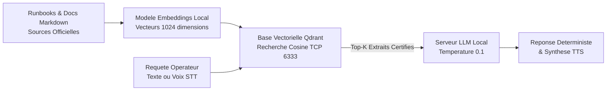

<!-- MASTER-HEADER-START -->
<div align="center">

<a href="https://0xcyberlitech.com/">
  
</a>

<p align="center">
  <a href="https://0xcyberlitech.com/"></a>
  <a href="https://0xcyberlitech.com/soc-rd.html"></a>
  <a href="https://0xcyberlitech.com/jarvis-rd.html"></a>
  <a href="https://github.com/0xCyberLiTech?tab=repositories"></a>
</p>
<p align="center">
  <a href="README.md"></a>
</p>


</div>
<!-- MASTER-HEADER-END -->

<!-- DEBIAN-TRUTH-START -->
> [!IMPORTANT]
>  ** Matrice Officielle Debian — `Debian 12 (Bookworm)` · `Debian 13 (Trixie)` · `Debian 14 (Forky)`**
> - **Sources Officielles Debian.org (`python3-defaults`) :** `Bookworm (12)` : **`3.11.2-1`** &nbsp;·&nbsp; `Trixie (13 — Stable)` : **`3.13.5-1`** &nbsp;·&nbsp; `Forky (14 — Next-Gen)` : **`3.14.7-3`**
> - **Références Officielles :** [Paquet Debian Trixie (`python3`)](https://packages.debian.org/trixie/python3) &nbsp;·&nbsp; [Paquet Debian Forky (`python3`)](https://packages.debian.org/forky/python3) &nbsp;·&nbsp; [Documentation Officielle Debian](https://wiki.debian.org/Python)
> - **Note d'Ingénierie (Divergence 13 vs 14) :** Depuis Debian 12/13 (Trixie) et renforcé sous Debian 14 (Forky), la norme **PEP 668** bloque `pip install` en global pour protéger APT : utilisez systématiquement `python3 -m venv` ou `pipx`.

<details>
<summary> <b>Afficher les Encarts Ligne de Commande : Debian 13 (Trixie — Stable) vs Debian 14 (Forky — Next-Gen)</b></summary>

####  Profil Production Stable — Commandes pour `Debian 13 (Trixie)`
```bash
# Debian 13 (Trixie — Python 3.13 & PEP 668) : Environnement virtuel obligatoire pour pip
sudo apt update && sudo apt install -y python3-venv python3-pip pipx
python3 -m venv .venv && source .venv/bin/activate
```

####  Profil Anticipation Next-Gen — Commandes pour `Debian 14 (Forky)`
```bash
# Debian 14 (Forky — Python 3.13/3.14) : Isolation stricte PEP 668 & outils CLI via pipx
pipx install huggingface-hub
python3 -m venv --upgrade-deps .venv
```

</details>
<!-- DEBIAN-TRUTH-END -->

<!-- CIEL-PEDAGOGY-START -->
<details>
<summary> <b>Synthèse d'Architecture, Standards Officiels &amp; Diagnostic (Niveau 1 : Fondamentaux · Niveau 2 : Repères · Niveau 3 : Diagnostic)</b></summary>

- **Niveau 1 — Fondamentaux &amp; Principe d'Architecture :** L'architecture d'**Intelligence Artificielle Souveraine (LLM Local, RAG Vectoriel & Pipeline Vocal)** permet d'orchestrer des modèles de langage (`Qwen 3.5`, `Llama`, `Mistral` via `Ollama`) et une recherche documentaire vectorielle privée (`SQLite-vec` / `Qdrant`) intégralement sur serveur local (*On-Premise*), garantissant la confidentialité absolue des données.
- **Niveau 2 — Repères Officiels (Ports IANA, Fichiers Debian &amp; Commandes de Validation) :** **Ports & Composants standards :** `TCP 11434` (API Ollama `qwen3.5:9b` / `qwen3-embedding:4b`) · Extension native `SQLite-vec` (`vec0` L2/Cosine) · `TCP 6333` (Qdrant) &nbsp;|&nbsp; **Validation & Télémétrie :** `nvidia-smi`, `ollama ps`, `curl -s http://127.0.0.1:11434/api/tags`.
- **Niveau 3 — Diagnostic d'Incidents &amp; Ingénierie Avancée :** **Diagnostic & Architecture :** Contrairement au *Fine-Tuning* qui fige des connaissances dans les poids du modèle, l'architecture **RAG (*Retrieval-Augmented Generation*)** indexe la documentation technique sous forme de vecteurs (*Embeddings*) et injecte dynamiquement les extraits exacts dans le contexte du LLM avec une `temperature` basse (`0.1`), éliminant les hallucinations.
- **Sources de Vérité Officielles Éditeurs &amp; Standards :** [Documentation Officielle Ollama](https://github.com/ollama/ollama) &nbsp;·&nbsp; [Documentation Officielle SQLite-vec](https://alexgarcia.xyz/sqlite-vec/) &nbsp;·&nbsp; [Documentation Llama.cpp / GGML](https://github.com/ggml-org/llama.cpp)

</details>
<!-- CIEL-PEDAGOGY-END -->


#  Architecture IA Souveraine On-Premise : LLM Local, RAG Vectoriel Qdrant & Pipeline Vocal sur Debian 12, 13 (Trixie) & 14 (Forky)

> **Objectif Opérationnel :** Déployer une infrastructure d'**Intelligence Artificielle 100 % locale et souveraine** sous **Debian 12 (Bookworm)**, **Debian 13 (Trixie — Stable)** et **Debian 14 (Forky — Next-Gen)** combinant un serveur d'inférence **Llama.cpp / Ollama**, une base de données vectorielle **Qdrant** pour la recherche documentaire sans hallucination (**RAG**) et un pipeline vocal faible latence.

<div align="center">

| Niveau | Étape Technique | Accès Direct |
|:---:|:---|:---:|
| **Niveau 1** | Architecture d'un pipeline RAG & Audio 100 % On-Premise (Zéro Cloud) | [](#architecture-rag-on-premise) |
| **Niveau 2** | Déploiement du moteur vectoriel Qdrant en conteneur durci | [](#deploiement-qdrant-vector-db) |
| **Niveau 2** | Serveur d'inférence LLM & Modèle d'Embeddings (`bge-m3` / `nomic-embed-text`) | [](#serveur-inference-llm-embeddings) |
| **Niveau 3** | Indexation documentaire déterministe & Requête hybride anti-hallucination | [](#indexation-requete-rag) |

</div>

---

<a id="architecture-rag-on-premise"></a>
##  01 // Architecture d'un pipeline RAG & Audio 100 % On-Premise (Zéro Cloud)


Dans une infrastructure critique ou un centre opérationnel de sécurité (SOC), aucune donnée technique ni aucun journal système ne doit quitter le réseau interne. L'architecture **RAG (*Retrieval-Augmented Generation*)** locale sépare la **mémoire documentaire** (stockée dans **Qdrant**) du **moteur de raisonnement** (**LLM local**) :



---

<a id="deploiement-qdrant-vector-db"></a>
##  02 // Déploiement du moteur vectoriel Qdrant en conteneur durci


Créez le répertoire persistant dédié aux collections vectorielles et déployez **Qdrant** en écoute stricte sur l'interface locale `127.0.0.1:6333` via `docker compose` :

<!-- CODE-WINDOW-START -->
> [!CAUTION]
> 
>
> ```bash
> sudo mkdir -p /opt/ia-souveraine/qdrant_storage
> sudo nano /opt/ia-souveraine/compose.yaml
> ```
<!-- CODE-WINDOW-END -->

Fichier `/opt/ia-souveraine/compose.yaml` :

<!-- CODE-WINDOW-START -->
> [!CAUTION]
> 
>
> ```yaml
> services:
>   qdrant:
>     image: qdrant/qdrant:latest
>     container_name: qdrant-rag
>     restart: unless-stopped
>     ports:
>       - "127.0.0.1:6333:6333"
>       - "127.0.0.1:6334:6334"
>     volumes:
>       - /opt/ia-souveraine/qdrant_storage:/qdrant/storage:z
> ```
<!-- CODE-WINDOW-END -->

Démarrez le service et validez sa sonde de santé HTTP :

<!-- CODE-WINDOW-START -->
> [!CAUTION]
> 
>
> ```bash
> cd /opt/ia-souveraine && sudo docker compose up -d
> curl -s http://127.0.0.1:6333/healthz
> ```
<!-- CODE-WINDOW-END -->

---

<a id="serveur-inference-llm-embeddings"></a>
##  03 // Serveur d'inférence LLM & Modèle d'Embeddings (bge-m3 / nomic-embed-text)


Pour transformer vos documents techniques en vecteurs numériques et générer les réponses localement, téléchargez un modèle d'embeddings multilingue (`bge-m3`) et un modèle d'instruction quantifié (`GGUF Q4_K_M`) :

<!-- CODE-WINDOW-START -->
> [!CAUTION]
> 
>
> ```bash
> ollama pull bge-m3
> ollama pull qwen2.5-coder:14b
> ollama list
> ```
<!-- CODE-WINDOW-END -->

Vérifiez que l'API locale d'embeddings répond sur `127.0.0.1:11434` :

<!-- CODE-WINDOW-START -->
> [!CAUTION]
> 
>
> ```bash
> curl -s http://127.0.0.1:11434/api/embeddings -d '{"model": "bge-m3", "prompt": "Test vectorisation Debian 13"}' | jq '.embedding | length'
> ```
<!-- CODE-WINDOW-END -->

---

<a id="indexation-requete-rag"></a>
##  04 // Indexation documentaire déterministe & Requête hybride anti-hallucination


Créez la collection `runbooks_infra` dans Qdrant avec une distance `Cosine` de dimension `1024` (correspondant à la sortie du modèle `bge-m3`) :

<!-- CODE-WINDOW-START -->
> [!CAUTION]
> 
>
> ```bash
> curl -X PUT http://127.0.0.1:6333/collections/runbooks_infra \
>   -H "Content-Type: application/json" \
>   -d '{"vectors": {"size": 1024, "distance": "Cosine"}}'
> ```
<!-- CODE-WINDOW-END -->

Lors de l'interrogation du modèle LLM, imposez une **`temperature` de `0.1`** et une consigne système stricte interdisant toute extrapolation hors des extraits retournés par Qdrant :

<!-- CODE-WINDOW-START -->
> [!CAUTION]
> 
>
> ```json
> {
>   "model": "qwen2.5-coder:14b",
>   "options": {
>     "temperature": 0.1,
>     "top_p": 0.9,
>     "num_ctx": 8192
>   },
>   "stream": false
> }
> ```
<!-- CODE-WINDOW-END -->

<!-- MASTER-FOOTER-START -->
<div align="center">


<a href="https://0xcyberlitech.com/">
  
</a>

<p align="center"><a href="https://0xcyberlitech.com/"></a></p>

<sub><b>Architecturé &amp; Forgé par Marc &amp; Antigravity (Google DeepMind)</b> &nbsp;·&nbsp; <a href="https://0xcyberlitech.com/"><b>0xcyberlitech.com</b></a> &nbsp;·&nbsp; <a href="https://0xcyberlitech.com/soc-rd.html">Architecture SOC Cockpit v5.5</a> &nbsp;·&nbsp; <a href="https://0xcyberlitech.com/jarvis-rd.html">Architecture JARVIS Mark-VII</a> &nbsp;·&nbsp; <a href="https://0xcyberlitech.com/blueprint-jarvis.html">Blueprint Matériel RTX 5080</a></sub>

</div>
<!-- MASTER-FOOTER-END -->
